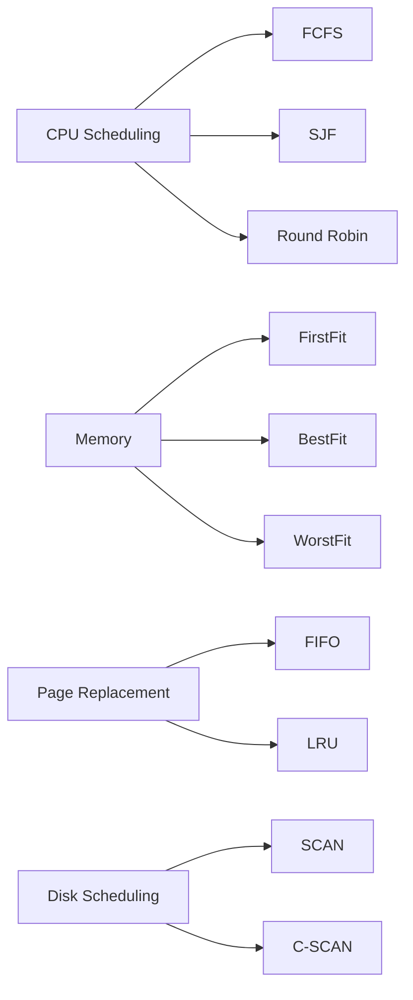

# 🌊 The C Lab Lifesaver — OS Edition

<div align="center">


[]()
[]()
[]()

</div>

A compact, student-friendly collection of classic **Operating Systems** lab programs implemented in **C** — CPU scheduling, page replacement, memory allocation, disk scheduling, process management, and more. This repo was made as a study / reference aid for OS practicals and lab exams. ([GitHub][1])

---

# 🔎 At a glance

* Language: **C (100%)**. ([GitHub][1])
* Includes canonical lab programs such as **FCFS, SJF, Priority Scheduling, Round Robin, LRU, FIFO, Banker’s algorithm, various disk scheduling (SCAN / C-SCAN)** and memory allocation demos. ([GitHub][1])
* Target audience: college students, TAs, and anyone revising OS practicals. ([GitHub][1])

---

# 🗂️ What’s in the repo (selected)

* `FCFS.c` / `FCFS.c.save` — First-Come First-Served scheduling
* `ROUND ROBIN.c` / `ROUND ROBIN.c.save` — Round Robin scheduler
* `PRIORITY SCHEDULING.c` — Priority scheduling example
* `fifo.c` / `LRU.c` — Page replacement demos (FIFO, LRU)
* `banker.c` — Banker’s algorithm for deadlock avoidance
* `c-scan.c` / `dsk FC.c` — Disk scheduling algorithms (SCAN / C-SCAN / FCFS)
* `bf.c`, `ff.c`, `wf.c` (typical memory allocation stubs)
  (Full file list visible in the repo.) ([GitHub][1])

---

# 🧭 Quickstart — compile & run

Make sure you have `gcc` (or equivalent) installed.

Compile & run an example (use the actual filename from repo — some filenames contain spaces/case):

```bash
# Clone (if you haven't already)
git clone https://github.com/prak05/The-C-Lab-Lifesaver-OS-Edition-.git
cd The-C-Lab-Lifesaver-OS-Edition-

# Compile FCFS (example) — replace name if different
gcc "FCFS.c" -o fcfs
./fcfs

# Compile Round Robin (note space in filename in this repo)
gcc "ROUND ROBIN.c" -o rr
./rr
```

Tips:

* If filenames have spaces (e.g., `ROUND ROBIN.c`) either rename locally or quote the name when compiling.
* Use `-Wall -Wextra` flags to catch warnings: `gcc -Wall -Wextra "FCFS.c" -o fcfs`.

---

# 🧠 Short descriptions & learning notes

* **CPU Scheduling (FCFS / SJF / Priority / RR):** Understand how turnaround and waiting times differ with preemptive vs non-preemptive policies. Try varying time quantum for Round Robin and observe effects. ([GitHub][1])
* **Page Replacement (FIFO / LRU):** Test with different reference strings to see hit/miss patterns. LRU approximates optimal when access locality exists. ([GitHub][1])
* **Memory Allocation (First Fit / Best Fit / Worst Fit):** Compare external fragmentation outcomes. ([GitHub][1])
* **Disk Scheduling (SCAN / C-SCAN / FCFS):** Visualize head movement to reason about average seek time. ([GitHub][1])

Mermaid study map:



---

# ✅ Contributing

Small, friendly rules:

1. Fork the repo.
2. Add/rename files with clear names (avoid spaces if possible).
3. Add a short `problem-name.md` alongside `.c` explaining input format, expected output, time/space complexity.
4. Run and test locally.
5. Open a PR with a clear title (e.g., `feat: add SJF preemptive with sample I/O`).

If you submit solutions for lab assignments, include comments explaining each step — it helps peers learn.

---

# 📘 Academic honesty

Use these programs to learn, not to blindly copy for submissions. Labs are learning experiences — type, debug, and understand the output. The goal is *understanding*, not just matching outputs. ([GitHub][1])

---

# 🧾 License

This repo follows the **MIT License** (see repository license). ([GitHub][1])

---

# 👤 Author

**prak05** — student-friendly OS lab solutions (see repo for full file list and examples). ([GitHub][1])

---

